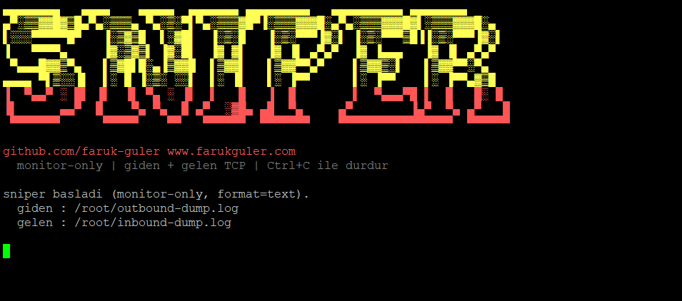

# The sniper eBPF deep monitoring tool



## Usage
```powershell
sudo python3 sniper.py
sudo python3 sniper.py --log-dir /dir
sudo python3 sniper.py --format json
sudo python3 sniper.py --no-cmd
```

## Log Read

```powershell
tail -f outbound-dump.log
tail -f inbound-dump.log
grep curl outbound-dump.log
grep ":443" outbound-dump.log
sort outbound-dump.log | awk '{print $4}' | sort | uniq -c | sort -rn | head
```

## Features
```powershell
```
